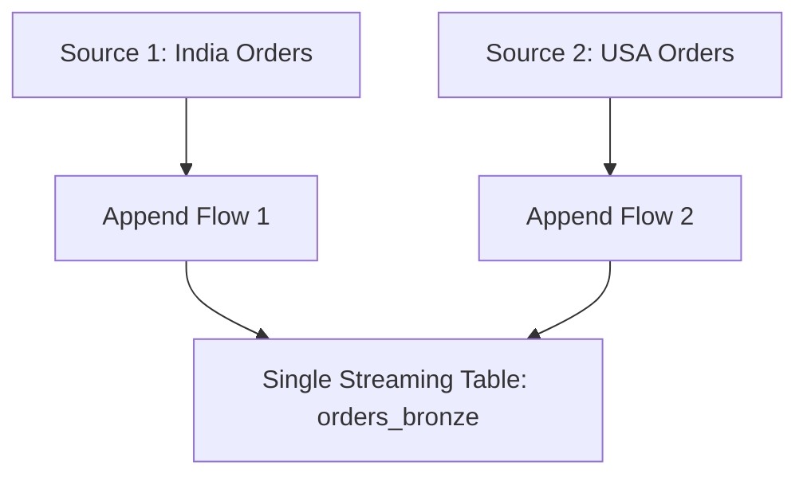
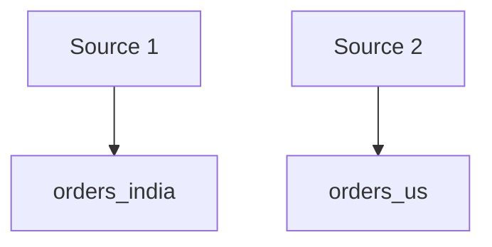
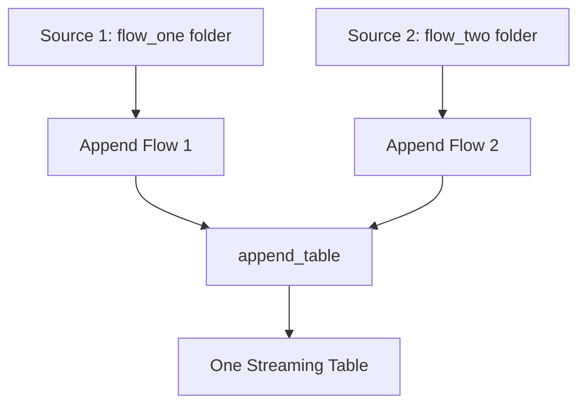

# Append Flow API in Databricks (DLT)

## 1. What is Append Flow?

**Append Flow** is used when multiple independent streaming data sources need to write into a single streaming table.

Instead of creating separate streaming tables for every source, we create:
- One target streaming table.
- Multiple independent append flows.
- Each flow reads from a different source and appends its data to the same target table.

### Example Scenario

Imagine an e-commerce company receiving order data from two different sources:

- Source 1: Orders from India.
- Source 2: Orders from the USA.

Both sources contain similar order information, and we want to combine their data into one Bronze streaming table.

### Architecture



**Requirement:** Two independent streaming flows, but only one destination streaming table.

---

## 2. Why do we need Append Flow?

Suppose we create two normal streaming tables:

```python
@dlt.table(name="orders_india")
def orders_india():
    return spark.readStream.format("cloudFiles") \
        .option("cloudFiles.format", "csv") \
        .load("/Volumes/main/bronze/flow_one/")

@dlt.table(name="orders_us")
def orders_us():
    return spark.readStream.format("cloudFiles") \
        .option("cloudFiles.format", "csv") \
        .load("/Volumes/main/bronze/flow_two/")
```

This creates two separate streaming tables:



However, our requirement is to have only one destination table.

An alternative is to combine the two tables using `UNION ALL`:

```sql
CREATE VIEW all_orders AS

SELECT * FROM orders_india

UNION ALL

SELECT * FROM orders_us;
```

Although this can combine the data, it requires separate ingestion tables and an additional combined dataset.

With Append Flow, both sources can directly contribute to the same streaming table.

---

## 3. How does Append Flow work?

Append Flow follows two main steps:

1. Create an empty streaming table.
2. Create multiple append flows that write into that table.

### Step 1: Create an empty streaming table

```python
import dlt

dlt.create_streaming_table(
    name="append_table"
)
```

**What happens?**

- Registers a streaming table called `append_table`.
- Prepares the destination for incoming data.
- Initially, it contains no records.

Think of it as creating an empty destination before connecting the sources.

### Step 2: Create Flow 1

```python
@dlt.append_flow(
    target="append_table",
    name="flow_one"
)
def flow_one():

    df = (
        spark.readStream
        .format("cloudFiles")
        .option("cloudFiles.format", "csv")
        .load("/Volumes/main/bronze/auto_volume/flow_one/")
    )

    return df
```

**Understanding the code:**

| Code | Purpose |
|---|---|
| `spark.readStream` | Reads data incrementally as a stream |
| `cloudFiles` | Uses Databricks Auto Loader |
| `cloudFiles.format = csv` | Specifies CSV as the source format |
| `load(path)` | Specifies the source directory |
| `@dlt.append_flow` | Defines an append flow |
| `target` | Specifies the destination streaming table |
| `name` | Gives the flow a unique name |

Notice that we use `@dlt.append_flow` instead of `@dlt.table`.

We don't want to create another table. We want to append the flow's output into an existing target.

### Step 3: Create Flow 2

```python
@dlt.append_flow(
    target="append_table",
    name="flow_two"
)
def flow_two():

    df = (
        spark.readStream
        .format("cloudFiles")
        .option("cloudFiles.format", "csv")
        .load("/Volumes/main/bronze/auto_volume/flow_two/")
    )

    return df
```

Notice what changed:

- Source directory changed to `flow_two`.
- Flow name changed to `flow_two`.
- Target remains `append_table`.

Both flows write into the same destination.

### Final Architecture



We can add Flow 3, Flow 4, Flow 5, etc., all targeting the same streaming table.

---

## 4. How does incremental ingestion work?

Each append flow maintains its own streaming progress/checkpoint.

Consider the following example:

| Day | Flow 1: New Orders | Flow 2: New Orders | Total New Records |
|---|---:|---:|---:|
| Day 1 | 100 | 200 | 300 |
| Day 2 | 50 | 30 | 80 |
| Day 3 | 80 | 60 | 140 |
| **Total** | **230** | **290** | **520** |

Each flow processes newly arriving data independently.

Previously processed files do not need to be ingested again during normal incremental execution.

### Advantages

1. **Incremental ingestion:** Processes newly arriving data instead of repeatedly processing all historical data.
2. **Independent flows:** Each source has its own streaming progress.
3. **Single destination:** Multiple sources contribute to one streaming table.
4. **Scalability:** New sources can be added by defining additional append flows.
5. **Idempotent processing:** Checkpoint-based progress helps avoid reprocessing previously processed source data during normal pipeline execution.

**Important:** Append Flow does not automatically remove duplicate business records. If the same order ID arrives through two different files or sources, both records can be appended. Business-key deduplication must be implemented separately.

---

## 5. What if we add another source?

Suppose the company starts receiving orders from the UK.

We can simply create another append flow:

```python
@dlt.append_flow(
    target="append_table",
    name="flow_three"
)
def flow_three():

    return (
        spark.readStream
        .format("cloudFiles")
        .option("cloudFiles.format", "csv")
        .load("/Volumes/main/bronze/auto_volume/flow_three/")
    )
```

No new destination table is required.

All three flows contribute to `append_table`.

---

## 6. Append Flow vs UNION ALL

| Feature | Append Flow | UNION ALL |
|---|---|---|
| Multiple sources | Yes | Yes |
| Single output dataset | Yes | Yes |
| Independent ingestion flows | Yes | Not inherently |
| Independent flow checkpoints | Yes | Depends on the streaming query design |
| Incremental processing | Yes | Supported in compatible streaming queries |
| Adding another source | Add another flow | Modify the combined query |
| Separate source-level ingestion | Yes | Depends on architecture |

**Important distinction:** UNION ALL itself does not prevent incremental processing. The advantage of Append Flow is that it provides independently managed ingestion flows. Changing a UNION-based pipeline definition can require a full refresh in some pipeline configurations.

---

## 7. Append Flow vs Auto CDC

These APIs serve different purposes.

| Requirement | API |
|---|---|
| Append incoming records from multiple sources | Append Flow |
| Insert new records | Append Flow |
| Update existing records based on source changes | Auto CDC |
| Apply delete events | Auto CDC |
| Maintain SCD Type 1 | Auto CDC |
| Maintain SCD Type 2 | Auto CDC |

Example:

Suppose a customer changes their city.

| Customer ID | Name | City |
|---|---|---|
| 101 | John | Mumbai |
| 101 | John | Pune |

Append Flow can append both records.

But if we want to update John's existing record or maintain historical versions, we need change-data processing such as Auto CDC.

---

## 8. Modern Databricks API

Databricks has evolved from the older DLT API to Lakeflow Spark Declarative Pipelines.

The modern API uses `pyspark.pipelines` and the `dp` namespace.

```python
from pyspark import pipelines as dp

# Step 1: Create the target streaming table

dp.create_streaming_table(
    name="append_table"
)

# Step 2: Flow 1

@dp.append_flow(
    target="append_table",
    name="flow_one"
)
def flow_one():

    return (
        spark.readStream
        .format("cloudFiles")
        .option("cloudFiles.format", "csv")
        .load("/Volumes/main/bronze/auto_volume/flow_one/")
    )


# Step 3: Flow 2

@dp.append_flow(
    target="append_table",
    name="flow_two"
)
def flow_two():

    return (
        spark.readStream
        .format("cloudFiles")
        .option("cloudFiles.format", "csv")
        .load("/Volumes/main/bronze/auto_volume/flow_two/")
    )
```

The underlying concept remains the same; the API namespace has changed.

---

## 9. When should we use Append Flow?

| Scenario | Use Append Flow? |
|---|---|
| Multiple CSV folders feeding one Bronze table | Yes |
| Multiple regional sources feeding one table | Yes |
| Multiple Kafka sources feeding one table | Yes |
| Updating existing customer records | No – use Auto CDC |
| Handling deletes and updates | No – use Auto CDC |
| Maintaining SCD Type 1 or Type 2 | No – use Auto CDC |

---

## 10. Quick Revision Notes

**Append Flow API**

- Used when multiple independent streaming sources need to write into one streaming table.
- First create the destination using `create_streaming_table()`.
- Define individual flows using `@append_flow()`.
- Specify the same `target` for every flow.
- Each flow has its own unique name and streaming progress.
- Supports incremental ingestion.
- Helps avoid unnecessary reprocessing during normal incremental execution.
- Does not automatically perform business-key deduplication.
- Does not handle updates and deletes like Auto CDC.

### Remember the core concept

**Multiple Sources → Multiple Append Flows → One Streaming Table**

### Next Topic: Auto CDC

Append Flow handles incoming records that need to be appended.

But what happens when an existing customer record changes?

For example, a customer's address changes from Mumbai to Pune.

Should both records remain in the final table, or should the existing record be updated?

This is where Auto CDC comes in. It connects directly to CDC and Slowly Changing Dimensions (SCD) Type 1 and Type 2.
